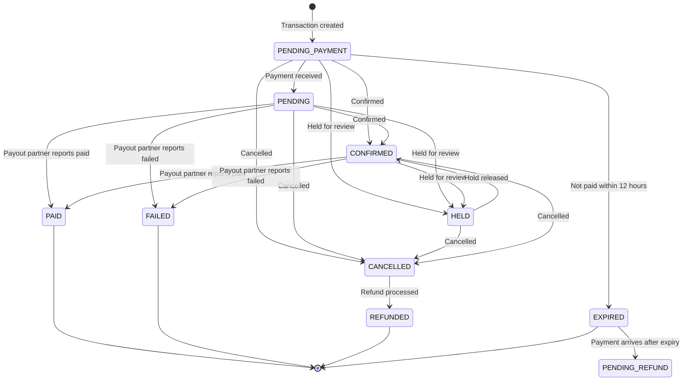

Every remittance transaction moves through a series of well-defined states from creation to completion. Understanding these states helps you build robust integrations and provide clear user feedback.

The status value is what the API returns, for example in `error.errorCategory` from [Check Transaction Status](/api/transactions/check-transaction-status). Each status also has a display label, shown on screens and returned in `error.errorDescription`.



## Statuses

| Status | Label | Meaning | Final |
|--------|-------|---------|-------|
| `PENDING_PAYMENT` | Waiting to pay | Booked, not yet funded | No. Becomes `EXPIRED` if not paid within 12 hours |
| `PENDING` | Verifying | Funded, being checked | No |
| `CONFIRMED` | Initiated | Confirmed, in progress | No |
| `HELD` | Held | On hold for review | No |
| `PAID` | PAID | Paid to the recipient | Yes |
| `PAID_OUT` | Completed | Paid out | Yes |
| `FAILED` | Failed to delivery | Payout failed | Yes |
| `CANCELLED` | Cancelled | Cancelled | Yes, unless a refund is then processed |
| `PENDING_REFUND` | pending refund | Payment arrived after the transaction expired | No. There is no automatic next step; our operations team resolves it |
| `REFUNDED` | Refunded | Refunded | Yes |
| `EXPIRED` | Expired | Not paid within 12 hours | Yes, unless an online payment arrives later, which moves it to `PENDING_REFUND` |
| `VOID` | Void | Voided | Yes |

"Final" means the status does not change again unless our operations team changes it.

<Info>
  Use the status values above in your integration, not the labels. For example, a transaction waiting for payment returns `PENDING_PAYMENT`, which is displayed as "Waiting to pay".
</Info>

## State Transition Triggers

### Payment

| From | To | Trigger |
|------|----|---------|
| `PENDING_PAYMENT` | `PENDING` | Payment received |
| `PENDING_PAYMENT` | `EXPIRED` | Not paid within 12 hours. The expiry check runs every 2 hours. |
| `EXPIRED` | `PENDING_REFUND` | An online payment arrives after the transaction has expired |

### Processing and payout

| From | To | Trigger |
|------|----|---------|
| `PENDING_PAYMENT` or `PENDING` | `CONFIRMED` | Transaction confirmed. Confirmation only goes ahead once a successful payment has been recorded. |
| `PENDING_PAYMENT`, `PENDING` or `CONFIRMED` | `HELD` | Transaction held for review |
| `HELD` | `CONFIRMED` | Hold released |
| `PENDING` or `CONFIRMED` | `PAID` | Payout partner reports the transfer paid |
| `PENDING` or `CONFIRMED` | `FAILED` | Payout partner reports the transfer failed |

Except for cash pickup, a transaction is sent to the payout partner once its payment has been collected and it has passed compliance; it does not need to be `CONFIRMED` first. The status does not change when a transaction is sent to the payout partner. The `TRANSACTION_STATUS` webhook sends `PENDING` with `msgCode` `000` ("pushed for payout") at that point.

### Cancellation and refunds

| From | To | Trigger |
|------|----|---------|
| `PENDING_PAYMENT`, `PENDING`, `CONFIRMED` or `HELD` | `CANCELLED` | Transaction cancelled |
| `CANCELLED` | `REFUNDED` | A refund is processed after cancellation |

A refund is paid into a wallet, not back to the original card or bank account.

<Card title="Webhook Configuration" href="/api/webhooks">
  Learn how to set up webhooks for real-time updates
</Card>

## API Reference

<CardGroup cols={2}>
<Card title="Transaction Status Endpoint" href="/api/transactions/check-transaction-status">
  View complete API documentation for tracking transaction status
</Card>

<Card title="Beneficiary Lifecycle" href="/remittance/beneficiary-lifecycle">
  Learn how to create and validate beneficiaries
</Card>
</CardGroup>

## Quote Calculator Integration

You can easily integrate a Quote Calculator into your own website or dashboard using our ready-made widget. This handles flag updates, country selection, and real-time exchange rates automatically.

### Integration Guide

Add the following code to your HTML page where you want the widget to appear:

<Steps>
  <Step title="Add the Container">
    Place this `div` in your layout. You can customize the initial values using `data-` attributes.

    ```html
    <div 
      id="fincode-remittance-widget" 
      data-default-send-country="GBR" 
      data-default-receive-country="NGA"
      data-button-text="Send Now"
      data-button-color="#000000"
    ></div>
    ```
  </Step>
  <Step title="Include the Script">
    Add this script tag at the bottom of your `<body>` tag.

    ```html
    <script src="https://quote.trillionclues.dev/widget.js"></script>
    ```
  </Step>
</Steps>

### Configuration Options

Customize the widget behavior by adding these attributes to the container `div`:

| Attribute | Description | Default |
| :--- | :--- | :--- |
| `data-default-send-country` | ISO3 Code for the default sending country | `GBR` |
| `data-default-receive-country` | ISO3 Code for the default receiving country | `NGA` |
| `data-default-amount` | Initial amount for the "Send" field | `100` |
| `data-button-text` | Text displayed on the main button | `Send Money Now` |
| `data-button-color` | Color code for the action button | `#000000` |

<Tip>
  The widget is fully responsive and will adapt to the width of its parent container. For the best experience, place it in a column between 350px and 500px wide. To see the full usage guide, follow this link https://fxquote-widget.vercel.app/index.html
</Tip>

